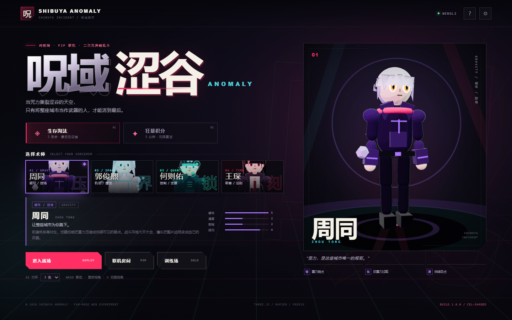
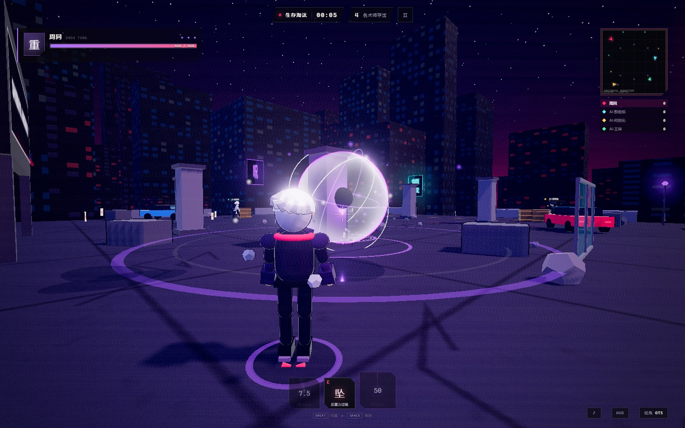
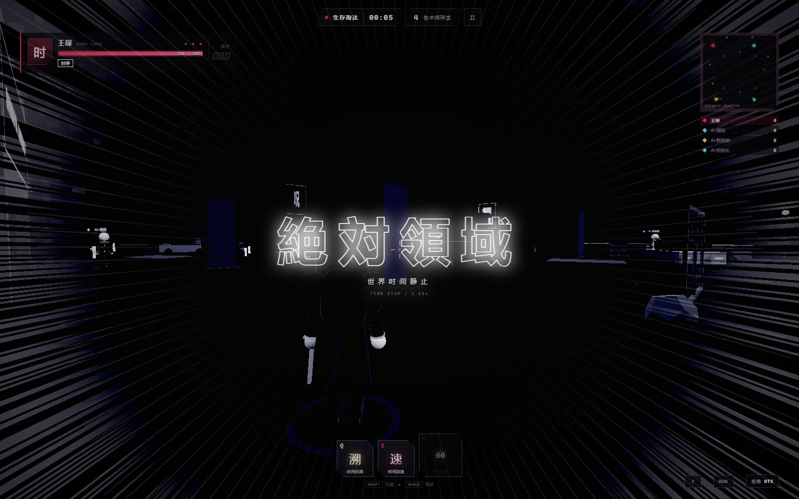
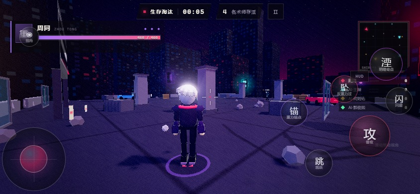

# 咒域·涩谷 / SHIBUYA ANOMALY

一款**纯前端、免付费服务**的 3D 二次元异能乱斗游戏。
使用 Three.js 做卡通渲染与后处理，Rapier3D 负责刚体物理与场景破坏，PeerJS 提供无后端 P2P 联机。

> 所有角色、城市、特效、音效均由代码程序化生成，项目不依赖任何商业素材或付费云服务。





| 绝对领域·时停 | 移动端 HUD |
| --- | --- |
|  |  |

## 快速开始

```bash
npm install
npm run dev
```

打开终端输出的地址（默认 `http://localhost:5173`）。

生产构建：

```bash
npm run build
npm run preview
```

`dist/` 是完整静态站点，可直接拖到任意静态托管。

## 直接部署

### GitHub Pages

1. 推送到 GitHub 仓库。
2. 本地执行 `npm run build`。
3. 将 `dist/` 目录发布到 `gh-pages` 分支（或使用 GitHub Actions）。
   项目已将 `vite.config.js` 的 `base` 设为 `'./'`，放在仓库子路径也能正常加载。

### Vercel / Netlify / Cloudflare Pages

- Build Command: `npm run build`
- Output Directory: `dist`
- 无需环境变量、无需服务端函数。

## 操作

### PC

| 输入 | 动作 |
| --- | --- |
| `W A S D` | 移动 |
| 鼠标 | 视角 / 瞄准（点击画面锁定指针） |
| 鼠标左键 | 普攻，连按组成三段/四段连击 |
| `Q` / `E` / `R` | 技能一 / 技能二 / 终极技能 |
| `Space` | 跳跃 |
| `Shift` | 闪避（短暂无敌） |
| `V` | 第一人称 / 第三人称越肩视角切换 |
| `Tab` | 积分榜 |
| `Esc` | 暂停 |

### 手机 / 平板

- 屏幕左半区按下并拖动：浮空虚拟摇杆。
- 屏幕右半区滑动：转动视角。
- 右侧虚拟按键：普攻、技能、跳跃、闪避、视角。
- 暂停菜单 → **自定义 HUD**：拖拽所有按键与摇杆，调整大小和透明度，自动保存到 `localStorage`。

## 玩法

### 模式

- **生存淘汰**：每人 3 条命，最后存活的术师获胜。掉下天台会损失一条命。
- **狂暴积分**：5 分钟无限复活，击杀、伤害和场景破坏都计分，时间结束按积分排名。
- **训练场**：自由练招，无限生命。

### 战斗系统

- 物理角色控制器 + 胶囊碰撞，可站在屋顶、被击飞撞上水泥柱/玻璃/汽车。
- 高速撞墙触发 **Wall-Splat**，追加伤害并造成眩晕。
- 柱子、玻璃幕墙、汽车、木箱均可被技能和普攻破坏，碎裂为 Rapier 动态刚体。
- 天台边缘没有完整护栏，可被击落；坠入涩谷街道即死/损失生命。
- 每名角色拥有独特普攻、被动、两个主动技能和一个超长 CD 大招。

### 四名术师

| 术师 | 定位 | 核心 |
| --- | --- | --- |
| 周同 | 破坏 / 控场 | 重力锚点、反重力陨石、坍缩黑洞 |
| 郭俊熙 | 机动 / 爆发 | 瞬移、因果置换、15 段空间乱打 |
| 何则佑 | 控制 / 支援 | 量子印记、隐形磁网、壁垒、命运矩阵 |
| 王琛 | 刺客 / 法则 | 时间残片、回溯、加速、全球时停 |

时停会触发全屏黑白灰阶、集中线与倒计时界面；时停期间王琛造成的伤害会在时间恢复时以动能形式再次爆发。

## 联机

- 纯 P2P，无需自建服务器；PeerJS 公共信令 + WebRTC 直连。
- **房主权威**：客户端发送输入和动作，房主负责物理、伤害和场景状态，以 16 Hz 广播快照，客户端平滑插值。
- 本地开房间 → 分享 6 位以内房间码 → 队友加入 → 房主开始。
- 若双方处于严格 NAT 后，WebRTC 可能需要 TURN 中继；目前使用免费 STUN，无法保证所有网络环境都能直连。
- 支持最多 4 名玩家，空位会用 AI 补齐。

## 技术栈

- **Three.js r186**：WebGL2 渲染、卡通阶梯着色、反向外壳描边、Bloom、自定义动漫调色 / 色散 / 时停 / 集中线后处理。
- **@dimforge/rapier3d-compat**：Kinematic Character Controller、刚体碎块、射线检测、镜头避障。
- **PeerJS**：轻量 WebRTC DataChannel 封装。
- 原生 ES Modules + Vite，无 UI 框架。
- WebAudio 程序化合成音效与氛围音乐。

## 目录结构

```
src/
  main.js                 启动流程
  style.css               全部界面与 HUD 样式
  data/characters.js      角色、技能、模式数据
  render/
    toon.js               卡通材质、gradientMap、描边
    postfx.js             Bloom + 自定义动漫后处理
  entities/
    characterModel.js     程序化二次元角色模型
    fighter.js            角色状态机、物理、连击、受击
    bot.js                AI 行为
  game/
    game.js               比赛循环、伤害、模式、网络同步
    abilities.js          四名角色的技能实现
    cameraRig.js          FPP / OTS 相机
  world/arena.js          涩谷天台、都市、可破坏物、灯光
  effects/effects.js      粒子、刀光、黑洞、传送门、矩阵、时停表现
  ui/
    ui.js                 菜单、HUD、HUD 编辑器、联机界面
    preview.js            角色展示舞台与卡面渲染
  net/p2p.js              PeerJS 房主权威联机
```

## 浏览器要求

- Chrome / Edge / Firefox / Safari 新版本。
- 必须支持 **WebGL2**（Three.js r186 的要求）。
- 联机需要 **WebRTC** 与互联网访问 PeerJS 公共信令服务；单机模式不需要联网。

## 备注

- 游戏名、角色名与技能文本均为原创演绎，与任何商业作品无关联。
- 物理与技能数值都在 `src/data/characters.js` 和 `src/game/abilities.js` 中，可直接调整。
- 若需要将 PeerJS 换成完全自托管信令，只需替换 `src/net/p2p.js` 中 `new Peer(...)` 的 `host` / `path` 配置。
